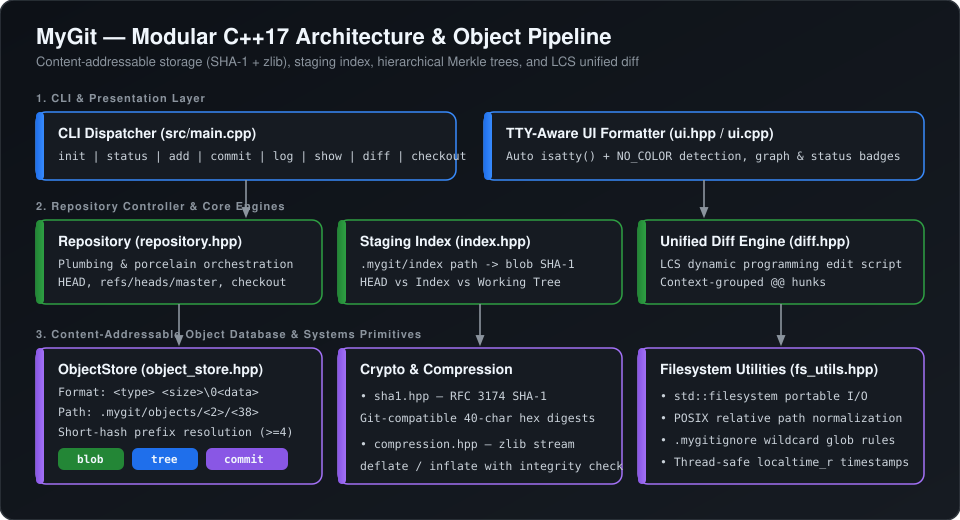
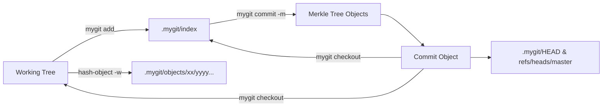
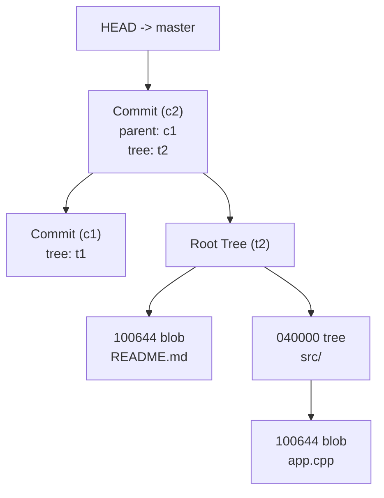

# MyGit — Content-Addressable Version Control System in C++17

**C++17** · **zlib** · **SHA-1 (RFC 3174)** · **Linux & macOS CI** · **MIT License**

**MyGit** is a modular, from-scratch Git-compatible version control engine written in modern C++17. It implements Git's content-addressable object database (`blob`, `tree`, `commit`), RFC 3174 SHA-1 hashing, zlib stream compression, a persistent staging index, hierarchical Merkle tree snapshots, short-hash prefix resolution, an LCS-based unified diff engine, and clean working-tree restoration (`checkout`).



## Key Features

- **Git-Compatible Content-Addressable Storage**: Formats objects as `<type> <size>\0<payload>`, computes RFC 3174 SHA-1 digests (producing identical blob hashes to upstream `git hash-object`), compresses with `zlib`, and stores immutable objects under `.mygit/objects/<2-hex>/<38-hex>`.
- **Abbreviated Hash Resolution**: Accepts both full 40-character SHA-1 hashes and unambiguous short prefixes (4+ hex characters) across `cat-file`, `ls-tree`, `show`, and `checkout`.
- **Staging Area & Three-Way Status**: Tracks staged paths in `.mygit/index` and computes accurate `status` across `HEAD <-> Index` (staged `A`/`M`/`D`), `Index <-> Working Tree` (unstaged `M`/`D`), and untracked files while honoring `.mygitignore` glob rules.
- **Hierarchical Tree Snapshots**: Builds nested recursive `tree` objects directly from the staging index on `commit` (or from the working directory on `write-tree`) with deterministic lexicographical sorting.
- **Unified Line-by-Line Diff**: Implements a Longest Common Subsequence (LCS) edit-script engine producing standard unified diff hunks (`@@ -a,b +c,d @@`) with context lines.
- **TTY-Aware CLI**: Automatically enables ANSI color formatting on interactive terminals and disables escape codes when output is piped or `NO_COLOR` is set (also supports `--no-color`).

## Object Model & Data Flow





## Project Structure

```text
mygit/
├── include/mygit/
│   ├── sha1.hpp            # RFC 3174 SHA-1 cryptographic digest engine
│   ├── compression.hpp     # zlib deflate / inflate stream wrappers
│   ├── fs_utils.hpp        # Portable filesystem I/O, path normalization, .mygitignore globbing
│   ├── object_store.hpp    # Content-addressable .mygit/objects DB & short-hash resolution
│   ├── index.hpp           # Persistent staging area (.mygit/index)
│   ├── diff.hpp            # LCS-based unified diff generator
│   ├── repository.hpp      # High-level plumbing & porcelain command controller
│   └── ui.hpp              # TTY-aware ANSI terminal formatting
├── src/
│   ├── main.cpp            # CLI argument parser & command dispatcher
│   ├── sha1.cpp
│   ├── compression.cpp
│   ├── fs_utils.cpp
│   ├── object_store.cpp
│   ├── index.cpp
│   ├── diff.cpp
│   ├── repository.cpp
│   └── ui.cpp
├── tests/
│   ├── unit_tests.cpp      # C++17 unit & integration test suite
│   └── e2e_tests.sh        # Isolated end-to-end CLI test suite
├── scripts/
│   └── demo.sh             # Non-destructive sandbox walkthrough
├── docs/images/
│   └── architecture.svg    # Vector architecture diagram
├── .github/workflows/
│   └── ci.yml              # Cross-platform Ubuntu & macOS CI pipeline
├── Makefile
├── .gitignore
├── LICENSE
└── README.md
```

## Quick Start

### Prerequisites

- C++17 compiler (`g++` or `clang++`)
- `zlib` development headers (`zlib1g-dev` on Debian/Ubuntu; bundled with Xcode Command Line Tools on macOS)
- GNU `make`

### Build & Test

```bash
# Compile binary with strict warnings (-Wall -Wextra -Wpedantic)
make

# Run both C++17 unit/integration tests and isolated CLI end-to-end tests
make test

# Run the interactive sandbox walkthrough
bash scripts/demo.sh
```

### Example Workflow

```bash
# Initialize a new repository
./mygit init

# Create and stage files
echo "Hello, MyGit!" > README.md
mkdir -p src && echo "int main() { return 0; }" > src/app.cpp
./mygit status
./mygit add .

# Commit staged snapshot
./mygit commit -m "Initial commit"

# Modify a tracked file and inspect unified diff
printf "Hello, MyGit!\nNow with LCS unified diff.\n" > README.md
./mygit diff

# Stage, commit, and view commit history
./mygit add README.md
./mygit commit -m "Update README"
./mygit log

# Time-travel to an earlier commit using a 7-character short hash
./mygit checkout <7-char-commit-hash>
```

## Command Reference

### Porcelain Commands

| Command | Description |
| :--- | :--- |
| `mygit init` | Initializes `.mygit/` (`objects/`, `refs/heads/`, `HEAD`, `index`) and default `.mygitignore`. |
| `mygit status` | Displays staged changes (`HEAD` vs index), unstaged changes (index vs working tree), and untracked files. |
| `mygit add <paths...>` | Stages files, directories, deletions, or `.` (respecting `.mygitignore`). |
| `mygit commit -m <msg>` | Builds a hierarchical tree from the staging index, writes a commit object, and updates `HEAD`. |
| `mygit log [-n <count>]` | Walks parent pointers from `HEAD` and renders a commit graph. |
| `mygit show <commit>` | Prints commit metadata and lists the commit's root tree snapshot. |
| `mygit diff` | Displays a unified line-by-line diff between staged blobs and modified working-tree files. |
| `mygit checkout <commit>` | Restores tracked files and `.mygit/index` to match the target commit snapshot. |

### Plumbing Commands

| Command | Description |
| :--- | :--- |
| `mygit hash-object [-w] <file>` | Computes the Git-compatible SHA-1 blob hash; `-w` also writes the zlib-compressed blob to `.mygit/objects/`. |
| `mygit cat-file <-p \| -s \| -t> <hash>` | Prints object contents (`-p`, pretty-printing trees), byte size (`-s`), or type (`-t`). |
| `mygit write-tree` | Recursively writes a `tree` object from the current working directory. |
| `mygit ls-tree [--name-only] <hash>` | Lists mode, type, hash, and filename (or names only) of a stored `tree` object. |

### Environment Variables

| Variable | Description |
| :--- | :--- |
| `MYGIT_AUTHOR_NAME` | Overrides commit author/committer name (default: `Rajath Gadagkar`). |
| `MYGIT_AUTHOR_EMAIL` | Overrides commit author/committer email (default: `rajathgadagkar@gmail.com`). |
| `NO_COLOR` | When non-empty, disables ANSI color output. |

## Author

**Rajath Gadagkar** — `rajathgadagkar@gmail.com`

## License

This project is licensed under the [MIT License](LICENSE).
